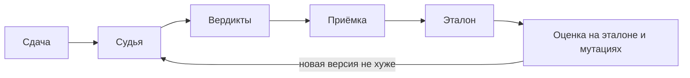

# mlsd-judge

Оценка качества и цикл улучшения LLM-агента, который проверяет
студенческие работы. Проект курса ML System Design.

## О проекте

На платформе Disputa студенты сдают работы через pull request, а
преподаватель принимает их по критериям курса. С осени 2026 года сверку
с критериями выполняет судья, LLM-агент: он изучает сдачу в песочнице и
по каждому критерию выносит вердикт «закрыт», «не закрыт» или «не
уверен», указывая, где в работе это видно.

Качество судьи пока не измерено. Самая опасная его ошибка: закрыть
критерий, который на самом деле не выполнен. Тогда студент не исправит
недочёт, а преподаватель не спросит о нём на приёмке.

Цель проекта: сделать вердикты надёжными, чтобы преподаватель не
перепроверял критерии, закрытые судьёй. Для этого собираем эталон из
вердиктов, размеченных людьми, и мутации сдач с известным ответом,
измеряем текущую версию и выпускаем новую, только если она не хуже.



Главная метрика: доля ложных «закрыто» на эталоне. Подробности в
[дизайн-документе](docs/ml_system_design_doc.md).

## Данные

Авторы сдач согласились на использование работ для оценки качества.
Сами сдачи в репозиторий не попадают, здесь хранятся только
обезличенные выгрузки и агрегаты. Каталог `data/raw/` исключён из git.

## Как начать

Нужен [uv](https://docs.astral.sh/uv/), он сам установит Python 3.13.

```bash
uv sync
uv run pre-commit install
```

Проверки:

```bash
uv run ruff check .
uv run ruff format .
uv run ty check
uv run pre-commit run --all-files
```

Перед каждым коммитом pre-commit проверяет форматирование файлов, ищет
секреты (`gitleaks`), сверяет `uv.lock` с `pyproject.toml`, запускает
ruff и ty и проверяет, что сообщение коммита написано по
[Conventional Commits](https://www.conventionalcommits.org/ru/v1.0.0/).

## Структура

    src/judge/       код судьи
    docs/            дизайн-документ
    pyproject.toml   зависимости и настройки ruff и ty

## Домашние работы

Каждая работа сдаётся через PR из ветки `hw_<n>` в `main`.

| ДЗ | Содержание |
|---|---|
| 1 | настройка репозитория, дизайн-документ |
| 2 | EDA, эталон, мутации, метрики |
| 3 | сравнение бейзлайнов и улучшенной версии |
| 4 | сервис, архитектура, нагрузочное тестирование |
