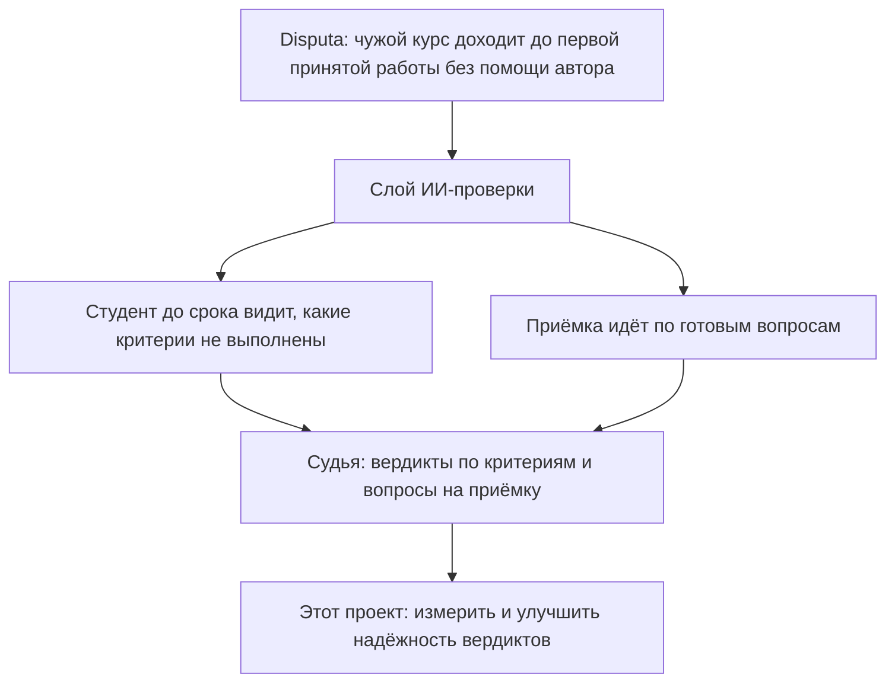
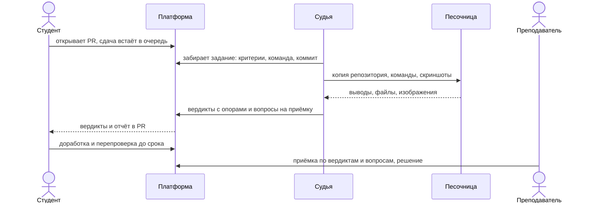
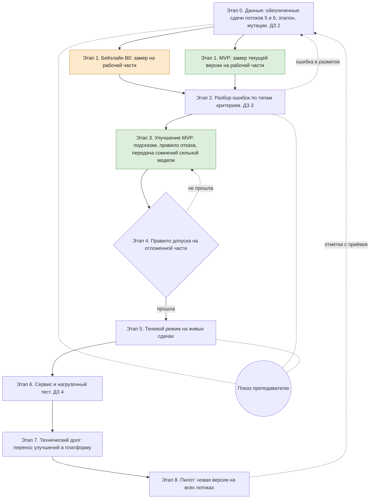
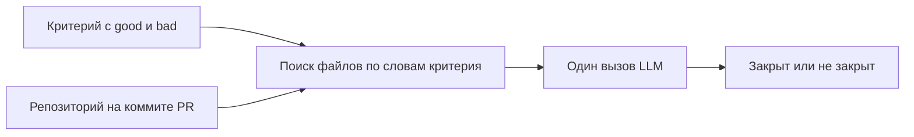
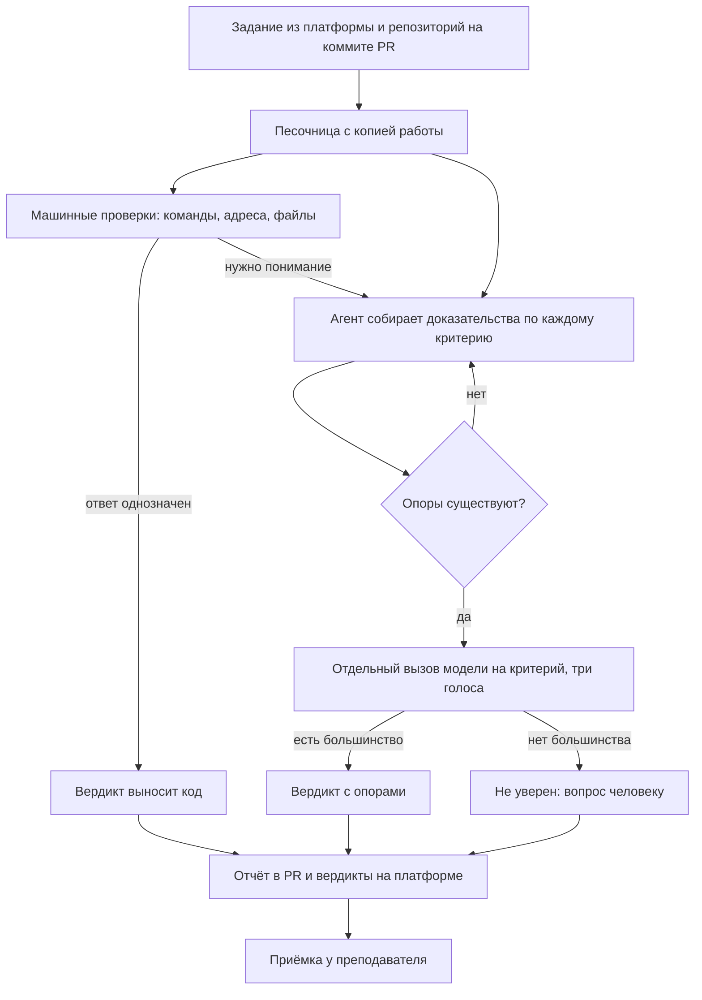
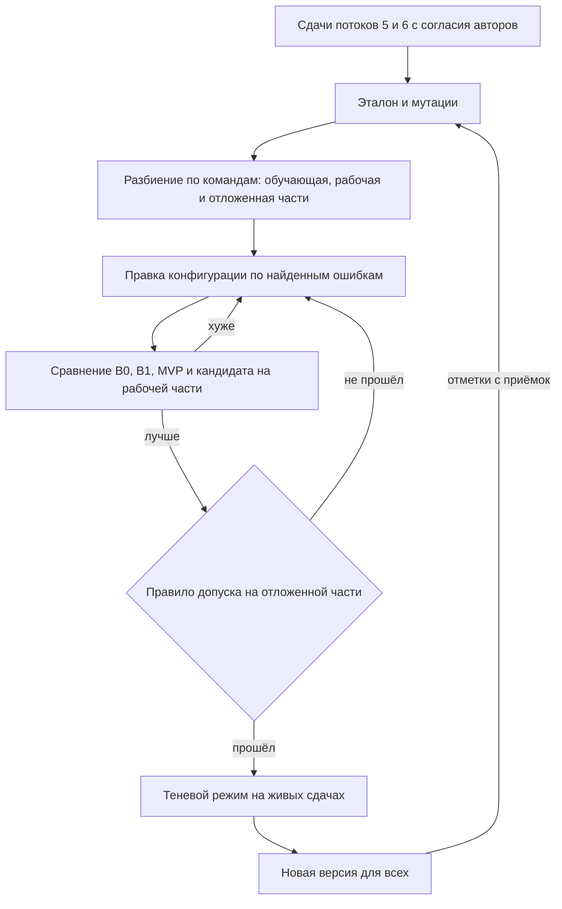

# Дизайн ML-системы «Судья студенческих работ», MVP 1

> **Цель.** Сделать вердикты судьи надёжными, чтобы преподаватель не
> перепроверял на приёмке критерии, которые судья закрыл.
>
> **Как измеряем.** Доверие: доля закрытых судьёй критериев, принятых на
> приёмке без замечаний. Надёжность: доля ложных «закрыто» на эталоне.
>
> **Срок.** Январь 2027 года.

Документ составлен по [шаблону Reliable ML](https://github.com/IrinaGoloshchapova/ml_system_design_doc_ru/blob/main/ML_System_Design_Doc_Template.md).
Раздел 2.3 и следующие заполним после EDA (ДЗ 2) и экспериментов (ДЗ 3
и 4).

#### Термины

- **Сдача**: pull request по работе на определённом коммите.
- **Критерий**: проверяемое требование к работе с признаками хорошего
  (`good`) и плохого (`bad`) выполнения.
- **Вердикт**: ответ судьи по одному критерию: «закрыт», «не закрыт» или
  «не уверен».
- **Опора**: место в работе, на котором основан вердикт.
- **Приёмка**: встреча преподавателя с командой, где принимается
  окончательное решение.
- **Эталон**: вердикты, размеченные людьми.
- **Мутация**: правка сдачи с заранее известным правильным ответом.

## 1. Цели и предпосылки

### 1.1. Зачем идём в разработку продукта?

#### Место судьи в системе

Disputa помогает вести проектные курсы: студенты сдают работы через pull
request, преподаватель принимает их по критериям. Главная цель
платформы: преподаватель другого вуза заводит курс и принимает первую
работу, ни разу не обратившись к автору системы. Слой ИИ-проверки
должен подтвердить две гипотезы. Первая: если студент до срока видит,
какие критерии не выполнены, работ, возвращённых за несоответствие
заданию, станет меньше. Вторая: приёмку можно проводить по вопросам,
подготовленным под конкретную работу.

Обе гипотезы держатся на судье, LLM-агенте, который проверяет сдачу по
критериям и готовит вопросы на приёмку. Судья работает на живых потоках
с 28 сентября 2026 года, но его качество не измерено, и правки
подсказок выкатываются вслепую. Этот проект строит оценку качества и
цикл улучшения судьи.

#### Бизнес-цель

Сделать вердикты судьи надёжными, чтобы преподаватель не перепроверял на
приёмке критерии, которые судья закрыл, а студент мог доверять
вердиктам до срока сдачи.

Ошибки судьи стоят по-разному. Ложное «закрыто» хуже всего: студент не
исправляет недочёт, преподаватель не задаёт по нему вопрос, и проблема
переходит в следующую работу. Ложное «не закрыто» обходится дешевле: оно
добавляет лишний вопрос на приёмке, и человек его снимает.

#### Почему нужна модель

Из 104 критериев курса 74 проверяются только пониманием текста, например
«целевые метрики измеримы и привязаны к пользе». Студенты называют и
раскладывают артефакты по-своему, поэтому искать их приходится по
смыслу, и правилами здесь не обойтись. Остальные 30 критериев (выполнить
команду, проверить адрес, найти файл) проверяет код без модели.

#### Бизнес-метрики

Метрики считаются по данным платформы: каждый вопрос приёмки связан с
критерием и с вердиктом судьи, а у приёмки есть таймер.

| Метрика | Как считаем | Цель итерации |
|---|---|---|
| Доверие | доля закрытых судьёй критериев, принятых на приёмке без замечаний | выше, чем у текущей версии |
| Пропуск на приёмке | доля закрытых судьёй критериев, отмеченных на приёмке как непринятые | ниже, чем у текущей версии |
| Минуты приёмки на работу | таймер приёмки | наблюдаем без цели: время зависит не только от судьи |

Доверие нельзя оценивать отдельно от надёжности. Если преподаватель
доверяет судье и перестаёт проверять, незамеченная ошибка выглядит как
принятый критерий. Поэтому доверие всегда смотрим вместе с долей ложных
«закрыто» на эталоне.

Замеров до появления судьи нет: он работает с первого потока. По
прикидке, ручная сверка одного PR занимала от 20 до 30 минут, но это не
измерение.

**Успех итерации:** эталон собран, качество текущей версии измерено с
доверительными интервалами, а хотя бы одна новая версия прошла правило
допуска (раздел 2.1) и превзошла текущую по доле ложных «закрыто».

### 1.2. Бизнес-требования и ограничения

Каждое требование проверяемо: в колонке «Как проверяем» указано, по
какой метрике и с каким порогом. Приоритет задан по MoSCoW: требование
обязательно, если без него продукт теряет смысл.

| № | Требование | Как проверяем | Приоритет |
|---|---|---|---|
| БТ-1 | По каждому критерию сдачи судья выносит один из трёх вердиктов: «закрыт», «не закрыт» или «не уверен» | у каждого критерия сдачи есть вердикт | обязательно |
| БТ-2 | Вердикты «закрыт» и «не закрыт» опираются на места, которые есть в работе | код проверяет каждую опору, несуществующих опор нет | обязательно |
| БТ-3 | Судья не закрывает невыполненные критерии | доля ложных «закрыто» на отложенной части эталона не выше, чем у текущей версии, и не выше доли расхождений двух разметчиков на той же части | обязательно |
| БТ-4 | При сомнении судья отвечает «не уверен», а не угадывает | покрытие не ниже, чем у текущей версии, при выполнении БТ-3 | обязательно |
| БТ-5 | Текст в работе, обращённый к проверяющему, не меняет вердикт | на мутациях со вставками вердикты не меняются | обязательно |
| БТ-6 | Судья находит такие вставки и показывает их преподавателю | найдено не меньше 90% вставок | желательно |
| БТ-7 | Вердикты готовы до приёмки | медиана до 7 минут, 95-й процентиль до 16 минут на сдачу | обязательно |
| БТ-8 | Новый курс подключается без изменения кода судьи | критерии и сроки приходят из платформы, в коде нет названий курсов | выполнено |
| БТ-9 | Новая версия выкатывается только после оценки на эталоне и откатывается переключением на прежнюю | правило допуска из раздела 2.1 | обязательно |

Абсолютного порога ошибок для автоматической проверки нет, поэтому
порог в БТ-3 задаём через людей: судья не должен ошибаться чаще, чем
расходятся между собой два разметчика. Так же устроено отраслевое
правило для автоматической оценки эссе: согласие машины с человеком
может быть ниже согласия двух людей не больше чем на 0,1 по κ
([ACT, по Williamson и др., 2012](https://www.act.org/content/dam/act/unsecured/documents/R2304-CRASE-Essay-Scoring-Model-Performance-02-2023.pdf)).

#### Типичный сценарий

Судья работает как раннер: сам забирает задачи у платформы и возвращает
вердикты.

Тот же судья работает и в оценочном режиме: проходит по случаям эталона,
а его вердикты никуда не публикуются.

#### Ограничения

- Окончательное решение принимает человек. Баллы и штрафы считает
  платформа, решение по приёмке принимает преподаватель.
- Работы студентов используются для оценки только с согласия авторов;
  для потоков 5 и 6 оно получено 1 октября 2026 года. В этот репозиторий
  попадают только обезличенные выгрузки и агрегаты.
- Работа студента считается недоверенными данными: инструкции из неё не
  исполняются, ключи не попадают в песочницу, судья не меняет чужие
  репозитории.
- Квота модели общая с рабочими проверками, поэтому оценочные прогоны
  идут в экономном режиме: с сохранёнными доказательствами и кэшем
  ответов модели.

#### Требования к работе системы

| Параметр | Требование | Сейчас |
|---|---|---|
| Время до вердиктов | медиана до 7 минут, 95-й процентиль до 16 минут на сдачу | 7 и 16 минут, максимум 28 |
| Сохранность сдач | сдача остаётся в очереди, пока по ней нет завершённого прогона | выполняется |
| Упавшие проверки | доля не растёт от версии к версии | 10 из 214 |
| Доступность в дни сдачи | не ниже 99% | не измерялась, мониторинг в ДЗ 4 |

#### Пилот

Пилот идёт с 28 сентября 2026 года на потоках курса «Системы ИИ».
Студент получает вердикты и отчёт в PR и может доработать сдачу до
срока. Преподаватель приходит на приёмку с вердиктами и вопросами и
ставит отметки. Отметки, перепроверки и разметка расхождений пополняют
эталон.

Версия, прошедшая правило допуска, сначала работает в теневом режиме:
проверяет те же сдачи, но её вердикты никому не показываются. После
сравнения с текущей версией её включают для всех.

| Критерий успешного пилота | Ориентир |
|---|---|
| Ложное «закрыто» на эталоне | ниже, чем у текущей версии |
| Согласие с людьми (κ Коэна) | не ниже 0,7 и не ниже согласия двух разметчиков минус 0,1 |
| Доверие и пропуск на приёмке | лучше, чем у текущей версии на тех же потоках |
| Время и цена проверки | не хуже, чем у текущей версии |

Дальше можно добавить модель доверия, которая предскажет, где судья
вероятнее ошибётся, и отдаст такие вердикты человеку.

### 1.3. Что входит в скоуп проекта/итерации, что не входит

#### Входит

- эталон и мутации со вставками (БТ-3, БТ-5, БТ-6);
- метрики качества и настройка ответа «не уверен» (БТ-3, БТ-4);
- замер времени и цены проверки, нагрузочный тест (БТ-7);
- регулярная оценка с правилом допуска и теневым режимом (БТ-9).

#### Не входит

- качество вопросов на приёмку: без расшифровок приёмок его не
  измерить;
- сама платформа и новые виды проверки;
- дообучение весов LLM: размеченных вердиктов сотни, а не десятки
  тысяч.

#### Воспроизводимость

- зависимости зафиксированы в `uv.lock`, на каждый коммит запускаются
  ruff, ty и pre-commit;
- ментор и ревьюеры смогут повторить оценку без наших ключей по кэшу
  ответов модели;
- разбиение эталона хранится в репозитории.

#### Технический долг

- код судьи живёт в репозитории платформы, здесь лежит его срез без
  секретов;
- эталон размечает в основном один человек, согласие двух разметчиков
  измеряем на части набора.

### 1.4. Предпосылки решения

- Судья решает одну задачу: закрыт ли данный критерий в данной сдаче.
  Баллы и итог по работе считает платформа.
- На вход приходят репозиторий на коммите сдачи и задание из платформы:
  критерии, роли, прошлые проверки. Сведений о конкретном курсе в коде
  судьи нет.
- Ответ «не уверен» допустим: сомнение превращается в вопрос человеку, а
  не в угаданный вердикт. Поэтому качество оцениваем вместе с покрытием,
  то есть с долей уверенных ответов.
- Что можно проверить командой, проверяет код. Модель подключается там,
  где нужно понимание.
- Опоры проверяет код: файл существует, строки попадают в диапазон,
  цитата совпадает с текстом работы. Иначе вердикт не выносится.
- Правильным ответом считается решение человека. Там, где ответ известен
  заранее, используем мутации.
- Данных немного, сотни вердиктов, поэтому веса не обучаем, а для каждой
  метрики указываем доверительный интервал.

## 2. Методология

### 2.1. Постановка задачи

Это бинарная классификация с возможностью отказа (selective
classification) по каждой паре «сдача и критерий». Классификатор решает,
закрыт ли критерий, а правило отказа решает, можно ли этому решению
доверять. Если нельзя, судья отвечает «не уверен», и критерий разбирает
человек. Решает задачу LLM-агент по схеме Agent-as-a-Judge: агент
собирает доказательства в песочнице, а вердикт по каждому критерию
выносит отдельный вызов модели.

| В терминах ML | У нас |
|---|---|
| Признаки | строки файлов, выводы команд, скриншоты, текст критерия |
| Целевая переменная | решение человека из эталона |
| Модель | конфигурация судьи: LLM, подсказки, инструменты, число голосов |
| Обучение | подбор конфигурации на обучающей части эталона по найденным ошибкам |
| Правило отказа | три ответа модели; если большинства нет, вердикт «не уверен» |
| Валидация | рабочая часть эталона; отложенная пятая часть используется только перед переключением версии |

Качество классификатора с отказом описывает кривая «покрытие и риск»
([Geifman и El-Yaniv, 2017](https://arxiv.org/abs/1705.08500)). Покрытие
здесь означает долю уверенных ответов, а риск означает долю ложных
«закрыто» среди них. Чем строже правило отказа (например, единогласие
трёх ответов вместо большинства), тем ниже риск и тем ниже покрытие.
Точку на кривой выбираем так, чтобы выполнялся порог из БТ-3 при
наибольшем покрытии.

Отказ не обязательно сразу означает работу для человека. Как в
[Trust or Escalate](https://arxiv.org/abs/2407.18370), сомнительный
случай можно сначала передать более сильной модели и только потом
человеку. Это главный кандидат на улучшение в ДЗ 3.

#### Метрики качества

Целевая метрика: доля ложных «закрыто». Её легко снизить, если чаще
отвечать «не уверен», поэтому рядом стоят контрольные метрики, которые
не должны ухудшаться.

| Метрика | Как считаем | Ориентир |
|---|---|---|
| **Ложное «закрыто»** | доля «закрыт» среди случаев, не закрытых по эталону | целевая |
| Покрытие | доля уверенных ответов | не ниже текущей версии |
| Согласие с людьми | κ Коэна по типам проверки | от 0,7 и не ниже согласия двух разметчиков минус 0,1 |
| Повторяемость | доля вердиктов, которые меняются между тремя прогонами | до 5% |
| Устойчивость к инъекциям | доля вердиктов, не изменившихся после вставки | 100% |
| Цена и время | токены и минуты на сдачу | не хуже текущей версии |

Согласие с людьми ещё не доказывает, что судья смотрит на суть работы.
Поэтому вслед за [исследованием валидности LLM-судей](https://arxiv.org/abs/2608.24419)
отдельно измеряем два свойства на мутациях:

| Свойство | Мутация и ожидаемый вердикт | Ориентир |
|---|---|---|
| Чувствительность | убрать артефакт, испортить признак из `bad` или сломать сборку; вердикт должен стать «не закрыт» | от 90% |
| Инвариантность | переименовать файл, добавить посторонний текст или пересказать другими словами; вердикт не должен измениться | от 95% |

Мутации готовит не та модель, на которой работает судья, а модель
другого семейства. Направление правки задаёт человек. Метрики считаем отдельно по типам проверки
(документ, код, веб), чтобы видеть, где судья слаб.

#### Связь с бизнес-метриками

- **Доверие и пропуск на приёмке** зависят от доли ложных «закрыто» и
  от чувствительности.
- **Минуты приёмки** зависят от покрытия: каждый ответ «не уверен»
  превращается в вопрос на приёмке.
- **Перепроверки** зависят от повторяемости и инвариантности: если
  вердикт меняется после переименования файла, студент перестаёт ему
  доверять.

#### Правило допуска новой версии

Версии сравниваем на одних и тех же случаях, интервалы строим бутстрепом
по сдачам. Кандидат заменяет текущую версию, если на отложенной части:

1. доля ложных «закрыто» не хуже, чем у текущей версии: верхняя
   граница 95-процентного интервала разницы не превышает допуск,
   заданный заранее (предлагаем 2 процентных пункта);
2. кандидат лучше хотя бы по доле ложных «закрыто», покрытию или цене;
3. контрольные метрики остаются в пределах ориентиров.

#### Бейзлайны и отвергнутые варианты

- **B0.** Один вызов модели на критерий: текст критерия и файлы,
  найденные поиском по его словам. Без песочницы и запуска кода.
  Показывает, что даёт сбор доказательств.
- **B1.** Прежняя версия судьи: подагенты, чьи находки пересказывает
  отдельный вызов модели.
- **MVP.** Текущая версия: сбор доказательств агентом и отдельный
  вердикт по каждому критерию на основе исходных доказательств. Модель
  отвечает трижды, и если большинства нет, вердикт становится «не
  уверен».

От обучаемого классификатора отказались: размеченных данных мало,
критерии меняются от курса к курсу, а классификатор не запустит код. От
одного агента, который и ищет, и судит, тоже: критерии начинают влиять
друг на друга, а агент доверяет своему рассуждению больше, чем работе.
От пересказа находок (B1) отказались, потому что при пересказе терялись
скриншоты и появлялись детали чужого проекта.

### 2.2. Блок-схема решения

#### Этапы проекта

Бейзлайн и MVP проходят одни и те же этапы. Пунктиром показаны возвраты
и точки, где результаты показываем преподавателю.

#### Устройство бейзлайна B0

#### Устройство MVP

#### Цикл улучшения

### 2.3. Этапы решения задачи

Этапы показаны на схеме в разделе 2.2. Входы, техники и ожидаемые
результаты каждого этапа распишем после EDA: этап 0 в ДЗ 2, этапы с 1 по 5
в ДЗ 3, этапы с 6 по 8 в ДЗ 4.

## Данные и риски

На 12 октября 2026 года судья провёл 214 проверок на 7 потоках и вынес
496 вердиктов по критериям. Студенты запросили 41 перепроверку, споров
с вердиктом не было ни одного. Закрыто 13 приёмок, проверяющие
отметили 197 вопросов. Оценок людей по отдельным критериям нет, поэтому
первым этапом станет эталон.

| Риск | Что делаем |
|---|---|
| Сдачи одной команды попадут в разные части эталона | разбиваем по командам |
| Подсказки подгоняются под рабочую часть | держим отложенную часть и смотрим на неё только перед переключением |
| Эталон размечает тот же человек, что пишет подсказки | второй разметчик на части набора, считаем κ |
| Провайдер меняет модель под тем же названием | записываем версию модели и перед сравнением заново измеряем текущую версию |
| Все данные с одного курса, а платформа рассчитана на чужие курсы | считаем метрики по типам критериев; когда появится второй курс, оценим судью на нём целиком |
