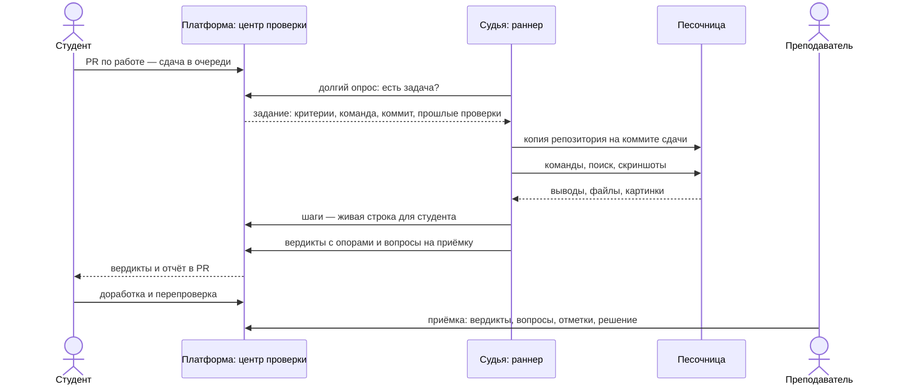
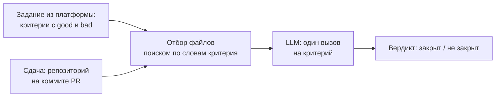
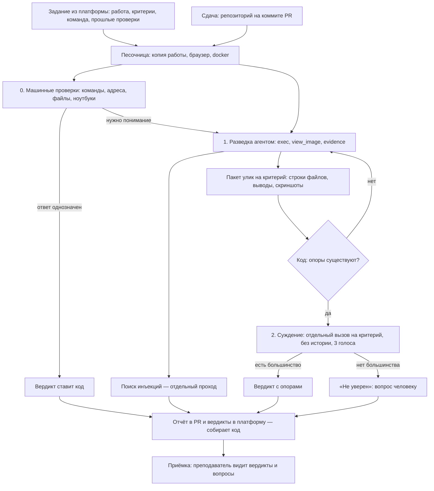
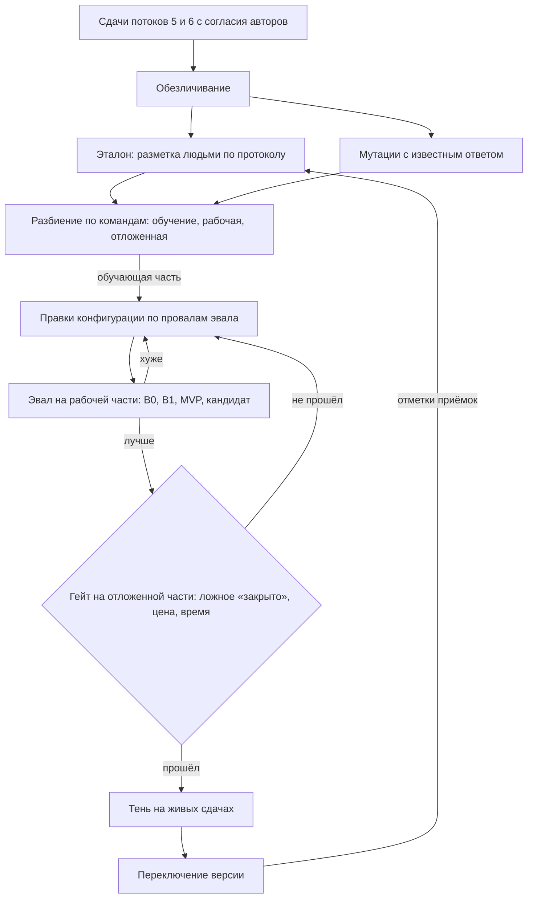

# Дизайн ML-системы — Судья студенческих работ, MVP 1

Проверка студенческих работ LLM-агентом: оценка качества и цикл
улучшения.

> **Цель.** Сделать вердикты судьи надёжными, чтобы преподаватель не
> перепроверял на приёмке критерии, которые судья закрыл.
>
> **Как измеряем.** Доверие — доля закрытых судьёй критериев, принятых на
> приёмке без замечаний; надёжность — доля ложных «закрыто» на эталоне.
>
> **Срок.** Январь 2027: эталон, замер текущей версии, одна улучшенная
> версия через гейт.

Документ — по [шаблону Reliable ML](https://github.com/IrinaGoloshchapova/ml_system_design_doc_ru/blob/main/ML_System_Design_Doc_Template.md).
Разделы 2.3 и дальше заполняются по результатам EDA (ДЗ 2) и
экспериментов (ДЗ 3–4).

> **Термины**
> - **Работа** — задание курса с критериями: «PRD продукта», «ER-диаграмма», «развернуть сервис».
> - **Сдача** — pull request студента или команды по работе, зафиксированный на коммите.
> - **Критерий** — проверяемое требование к работе: текст, способ проверки, признаки «хорошо» (`good`) и «плохо» (`bad`).
> - **Вердикт** — ответ судьи по одному критерию одной сдачи: «закрыт», «не закрыт» или «не уверен», с опорами.
> - **Опора** — место в работе, на котором держится вердикт: файл и строки, вывод команды, скриншот.
> - **Приёмка** — встреча преподавателя с командой: вопросы по работе и окончательное решение человеком.
> - **Судья** — LLM-агент, который выносит вердикты и готовит вопросы на приёмку.
> - **Эталон** — вердикты, размеченные людьми; правильный ответ для эвала.
> - **Эвал** — прогон версии судьи на эталоне и мутациях с подсчётом метрик.

---

## 1. Цели и предпосылки

### 1.1. Зачем идём в разработку продукта?

**Как сейчас.** На проектных курсах платформы Disputa студенты сдают
работы pull request'ом, а преподаватель принимает их по критериям курса.
Большая часть времени приёмки уходит на сверку: есть ли в репозитории нужный артефакт, отвечает ли он
признакам критерия, запускается ли код. Сверка рутинна, но без неё
вопросы на приёмке получаются общими, а пропущенные недочёты всплывают
только в следующей работе.

С 28 сентября 2026 эту сверку делает судья: он читает сдачу в песочнице
и по каждому критерию выносит вердикт с опорами. Преподаватель приходит
на приёмку с готовыми вердиктами и вопросами.

**Бизнес-цель — сделать вердикты судьи надёжными, чтобы преподаватель
не перепроверял на приёмке критерии, которые судья закрыл.** Тогда время
приёмки уходит на спорное и на понимание работы командой, а не на сверку.

Измеряем двумя метриками в паре:

- **доверие** — доля закрытых судьёй критериев, принятых на приёмке без
  замечаний. Считается из данных платформы;
- **надёжность** — доля ложных «закрыто» на эталоне.

Одной метрики доверия мало: преподаватель, который доверяет судье,
перестаёт проверять, и ошибка, которую никто не заметил, выглядит как
принятый критерий. Эталон ловит и незамеченные ошибки. Срок — январь
2027, конец курса.

**Почему без ML не обойтись.** Из 104 критериев в каталоге курса 74
проверяются только пониманием текста: «целевые метрики измеримы и
привязаны к пользе», «у каждого риска есть план реагирования». Правилом
или регулярным выражением их не проверить: студенты называют и
раскладывают артефакты по-своему, и найти артефакт нужно по смыслу.
Остальные 30 (запустить команду, проверить адрес, наличие файлов)
проверяются кодом без модели — так и делаем.

**Проблема, которую решает проект.** Судья работает, но его качество
никто не измерил. Человеческих оценок по критериям нет: кнопками «зря
закрыл / зря не закрыл» за первые две недели не воспользовался никто.
Любая правка подсказки или модели сейчас выкатывается вслепую. Ошибки
стоят по-разному:

- **ложное «закрыто»** — пропущенный недочёт. Преподаватель доверяет
  вердикту, не спрашивает об этом на приёмке, и долг уходит в следующую
  работу. Самая дорогая ошибка;
- **ложное «не закрыто»** — лишний вопрос на приёмке и недоверие
  студентов к агенту. Дешевле: человек его увидит и снимет.

**Успех итерации для бизнеса:**

1. Есть эталон, и качество текущей версии судьи измерено с доверительными
   интервалами: сколько ложных «закрыто», насколько судья согласен с
   людьми.
2. Есть цикл улучшения: новая версия выкатывается, только если на
   отложенной части эталона она не хуже прежней по ложному «закрыто» и
   не дороже и не медленнее заметно.
3. Хотя бы одна новая версия прошла этот цикл и стала лучше текущей по
   главной метрике.

**Бизнес-метрики и откуда их берём.** Всё считается из данных
платформы: вопросы приёмки привязаны к критерию и к вердикту судьи, у
приёмки есть таймер.

| Метрика | Как получаем | На 12.10.2026 |
|---|---|---|
| **Доверие** — доля критериев, закрытых судьёй, принятых на приёмке без замечаний | вопрос приёмки ссылается на критерий и вердикт судьи; отметку ставит проверяющий | считаем в EDA (ДЗ 2) |
| **Пропуск на приёмке** — доля критериев, закрытых судьёй, по которым вопрос на приёмке отмечен как не принятый | вопрос приёмки ссылается на критерий и вердикт судьи; отметку ставит проверяющий | считаем в EDA (ДЗ 2) |
| **Минуты приёмки на работу** | таймер приёмки: от начала разговора до решения, проверяющий может поправить его на перерыв | 13 закрытых приёмок, распределение — в EDA |
| **Перепроверки на сдачу** — студент не согласен или доработал | счётчик перепроверок | 41 на 202 проверки |
| **Споры с вердиктом** — кнопки «зря закрыл / зря не закрыл» | счётчик отметок | 0 |

Замеров «до судьи» на платформе нет: судья работает с первого потока.
Ручная сверка одного PR по критериям оценивалась в 20–30 минут — это
оценка, а не замер. Поэтому минуты приёмки — наблюдаемая метрика без
цели на эту итерацию: на них влияет не только судья.

### 1.2. Бизнес-требования и ограничения

**Бизнес-требования:**

| # | Требование |
|---|---|
| БТ-1 | Вердикт по каждому критерию сдачи — «закрыт», «не закрыт» или «не уверен» — с опорами на настоящие места в работе |
| БТ-2 | Ложных «закрыто» — как можно меньше; при сомнении судья отвечает «не уверен», и критерий разбирает человек |
| БТ-3 | Вердикты готовы до приёмки: в дни массовой сдачи — не дольше, чем сейчас (медиана 7 мин, 95% — 16 мин на сдачу) |
| БТ-4 | Вопросы на приёмку — по слабым местам конкретной работы, с местом в работе |
| БТ-5 | Судья не знает о конкретном курсе: критерии, роли и сроки приходят из платформы; новый курс — без релиза судьи |
| БТ-6 | Новая версия судьи выкатывается только после эвала; откат — переключением на прежнюю |

**Типичный сценарий.** Потребитель судьи — платформа: судья работает
раннером, сам забирает задачи у центра проверки долгим опросом и
возвращает вердикты. Платформа показывает их студенту и преподавателю.

Второй потребитель — эвал: тот же судья прогоняется по случаям эталона,
вердикты перехватываются и никуда не публикуются.

**Бизнес-ограничения:**

- **Окончательное решение — за человеком.** Судья не ставит баллов и не
  закрывает работу: баллы и штрафы считает платформа, решение по
  приёмке принимает преподаватель.
- **Данные студентов.** Работы используются для эвала только с согласия
  авторов (получено для потоков 5 и 6, 1 октября 2026). Сырые сдачи не
  выходят из закрытого хранилища; в этот репозиторий, ментору и
  ревьюерам — только обезличенные выгрузки и агрегаты.
- **Безопасность.** Работа студента — недоверенные данные из интернета:
  инструкции из неё не исполняются, ключи модели и токены не попадают в
  песочницу, судья не делает необратимых действий (не мержит, не правит
  чужие репозитории).
- **Цена.** Токены модели и песочницы общие с живыми проверками. Эвал не
  должен мешать проверкам потоков: дешёвый режим с сохранённой
  разведкой и кэшем ответов модели.
- **Живой семестр.** Судья проверяет сдачи каждый день; эксперименты не
  трогают прод, переключение версии — только между сроками сдачи.

**Требования к работе системы:**

| Что | Требование | Сейчас |
|---|---|---|
| Время до вердиктов | медиана ≤ 7 мин, 95% ≤ 16 мин на сдачу; в день срока очередь разбирается до приёмок | медиана 7, 95% — 16, максимум — 28 мин |
| Сохранность сдач | сдача не теряется: она остаётся в очереди, пока по ней нет завершённого прогона | падение раннера ничего не теряет — сдача уходит на повтор |
| Доля упавших проверок | не растёт от версии к версии; упавшая проверка не публикует частичных вердиктов | 10 из 214 |
| Восстановление | перезапуск раннера без ручного разбора очереди | так и устроено |
| Доступность в дни сдачи | ≥ 99% времени судья забирает задачи | не замерялась, мониторинг — в ДЗ 4 |

**Что ждём от итерации** (курс ML System Design, октябрь 2026 — январь
2027):

- эталон из 100–150 размеченных вердиктов, часть — двумя разметчиками;
- набор мутаций с известным ответом;
- метрики текущей версии и двух бейзлайнов на эталоне и мутациях;
- одна улучшенная версия, прошедшая гейт;
- сервис для получения вердиктов по сдаче и нагрузочный тест.

**Бизнес-процесс пилота.** Пилот уже идёт на живых потоках курса
«Системы ИИ» (4 и 6 курс) с 28 сентября 2026:

1. Команда открывает PR по работе; платформа ставит сдачу в очередь
   проверки.
2. Судья поднимает песочницу с копией репозитория на коммите сдачи,
   выносит вердикты и пишет вопросы на приёмку.
3. Студент видит вердикты и отчёт в PR и может доработать сдачу до
   приёмки — перепроверка по кнопке.
4. Преподаватель на приёмке видит вердикты и вопросы, задаёт вопросы,
   ставит отметки и окончательное решение.
5. Отметки на приёмке, перепроверки и разметка расхождений копятся в
   эталон.

Новая версия, прошедшая гейт, пойдёт **в тень**: будет проверять те же
сдачи рядом с текущей, её вердикты пишутся отдельно и никому не
показываются. После сравнения — переключение. Режим тени — часть этой
итерации, сейчас версия переключается настройкой `JUDGE_ENGINE`.

**Успешный пилот:**

| Критерий | Ориентир |
|---|---|
| Ложное «закрыто» на эталоне | ниже, чем у текущей версии, с непересекающимися интервалами — или не выше при заметно меньшей цене |
| Согласие с людьми (κ Коэна) | ≥ 0,7 |
| Доверие | выше, чем у текущей версии на тех же потоках, — при ложном «закрыто» не выше |
| Пропуск на приёмке | ниже, чем у текущей версии на тех же потоках |
| Время и цена проверки | не хуже текущей версии |

**Пути развития:** модель доверия — предсказывать, где судья ошибётся, и
отдавать такие вердикты человеку; оценка перекрёстного ревью студентов
по вердиктам судьи; другие хостинги кода.

### 1.3. Что входит в скоуп проекта/итерации, что не входит

**Входит:**

| БТ | Что делаем |
|---|---|
| БТ-1, БТ-2 | эталон, мутации, метрики качества; улучшение суждения по провалам эвала |
| БТ-2 | калибровка «не уверен»: доля сомнений против ложных «закрыто» |
| БТ-3 | замер времени и цены на сдачу; нагрузочный тест очереди и раннеров |
| БТ-6 | эвал как регулярный цикл: рабочая и отложенная части, гейт, режим тени |

**Не входит:**

- БТ-4 (вопросы на приёмку) — их качество измерить без расшифровок
  приёмок нельзя; оставляем как есть;
- БТ-5 — уже выполнено, судья не знает о курсах; не трогаем;
- сама платформа: экраны, ведомость, приёмка, баллы и штрафы;
- новые виды проверки: нативные мобильные приложения, видео;
- дообучение весов LLM: данных — сотни вердиктов, а не десятки тысяч;
  меняем конфигурацию судьи, а не модель.

**Качество кода и воспроизводимость:**

- зависимости зафиксированы в `uv.lock`, ruff, ty и pre-commit на каждый
  коммит;
- эвал воспроизводится у ментора и ревьюеров **без наших ключей**: кэш
  ответов модели и сохранённая разведка лежат рядом с обезличенным
  набором;
- каждый прогон эвала — JSONL с вердиктами, версией судьи и ссылками на
  трассы; отчёт строится из него кодом;
- разбиение эталона фиксировано и хранится в репозитории (ID случаев),
  отложенная часть не используется при подборе подсказок.

**Технический долг:**

- код судьи живёт в монорепозитории платформы; здесь — срез без
  платформы и секретов, улучшения переносятся обратно руками;
- эталон размечает в основном один человек; согласие разметчиков — на
  части набора;
- полный эвал на всех сдачах с настоящей моделью — дорог; в курсе —
  дешёвый режим, полный — перед переключением версии.

### 1.4. Предпосылки решения

- **Единица предсказания — пара «сдача × критерий».** Судья отвечает на
  один вопрос: закрыт ли этот критерий в этой сдаче. Баллы, штрафы за
  срок и итог работы считает платформа по вердиктам и решению человека.
- **Вход — состояние репозитория на коммите сдачи** и задание из
  платформы: текст работы, критерии с признаками `good` и `bad`, состав
  команды и роли, прошлые проверки. Ничего о курсе в коде судьи нет.
- **Три исхода, а не два.** «Не уверен» — честный ответ: сомнение уходит
  человеку вопросом на приёмку, а не превращается в угаданный вердикт.
  Поэтому качество меряем вместе с покрытием — долей уверенных ответов.
- **Сначала машинные проверки.** Критерии вида «команда завершается без
  ошибки», «адрес отвечает», «файл есть» проверяет код. Модель — только
  там, где нужно понимание.
- **Опору проверяет код.** Путь есть в репозитории, строки в диапазоне,
  вывод команды был, цитата — подстрока улики. Не сошлось — вердикта нет.
  Поэтому «честность опор» не метрика модели, а инвариант.
- **Горизонт — минуты.** Вердикт нужен до приёмки и до срока
  исправлений: медиана сейчас 7 минут, в дни сдачи — очередь.
- **Правильный ответ — суждение человека.** Эталон размечается по
  протоколу: закрыт / не закрыт / не уверен, верна ли опора. Там, где
  правильный ответ известен заранее, — мутации сдач.
- **Данные — реальные сдачи потоков 5 и 6.** Сотни вердиктов, не тысячи:
  отсюда выбор методов без обучения весов и доверительные интервалы на
  каждой метрике.

---

## 2. Методология

### 2.1. Постановка задачи

**Тип задачи — классификация с отказом** (selective classification) по
каждому критерию. Решается не обученным классификатором, а LLM-агентом
по схеме Agent-as-a-Judge: агент сам собирает улики в песочнице, а
вердикт выносит отдельный вызов модели на один критерий.

| В терминах ML | У нас |
|---|---|
| Объект | пара «сдача × критерий» |
| Признаки | улики: строки файлов, выводы команд, скриншоты; текст и признаки критерия |
| Целевая переменная | вердикт человека из эталона: закрыт / не закрыт |
| Ответ модели | закрыт / не закрыт / не уверен + опоры |
| Модель | конфигурация судьи: LLM, подсказки разведки и суждения, инструменты, бюджет шагов, число голосов |
| Обучение | подбор конфигурации на обучающей части эталона: правки подсказок по провалам эвала, затем оптимизация подсказок и примеров по метрике |
| Валидация | рабочая часть эталона; отложенная пятая часть — только перед переключением версии |
| Дообучение и замена | новая версия проходит гейт на отложенной части и тень на живых сдачах; откат — прежней версией |

**Целевая метрика — доля ложных «закрыто»**: «закрыт» там, где эталон
«не закрыт». Её можно улучшить, просто чаще отвечая «не уверен», поэтому
рядом — сдерживающие метрики: улучшение целевой не должно покупаться их
ухудшением.

| Метрика | Как считаем | Ориентир |
|---|---|---|
| **Ложное «закрыто»** | доля «закрыт» среди случаев с эталоном «не закрыт» | целевая, ↓ |
| Покрытие | доля уверенных ответов | не ниже текущей версии |
| Ложное «не закрыто» | доля «не закрыт» среди случаев с эталоном «закрыт» | не выше текущей версии |
| Согласие с людьми | κ Коэна; точность и полнота «закрыт» по типам проверки | κ ≥ 0,7 |
| Повторяемость | перевёрнутые вердикты на трёх прогонах одной сдачи | ≤ 5% |
| Инъекции | вердикты не изменились / вставка найдена | 100% / ≥ 90% |
| Цена и время | токены, минуты, упавшие песочницы на сдачу | не хуже текущей версии |

Ориентиры — стартовые, уточним после замера текущей версии (ДЗ 3).
Метрики считаются отдельно по типам проверки (документ, код, веб): общее
число прячет, где судья слаб.

**Валидность судьи.** Согласие с людьми не доказывает, что судья
смотрит на то, что нужно: высокий κ бывает и у судьи, который почти не
реагирует на суть работы. Поэтому мерим два свойства отдельно — как в
[работе о валидности LLM-судей](https://arxiv.org/abs/2608.24419):

| Свойство | Правка сдачи | Вердикт должен | Ориентир |
|---|---|---|---|
| **Чувствительность R** — реагирует на суть | убрать артефакт; испортить признак из `bad`; сломать сборку или страницу | стать «не закрыт» | ≥ 90% |
| **Инвариантность S** — не реагирует на форму | переименовать или перенести файл; добавить посторонний текст; переписать те же мысли другими словами | не измениться | ≥ 95% |

- S и R показываем вместе и по каждому виду правки: судья может хорошо
  замечать пропажу артефакта и плохо — ослабление его содержания.
- Направление правки задаёт человек, а не модель: что считать порчей
  признака, решает разметчик.
- Правки готовит модель другого семейства, чем судья, — чтобы не
  совпадали их слепые зоны.
- Эталон проверяем на простоту: если вердикт человека угадывается по
  поверхностным признакам (длина документа, есть ли файл с похожим
  именем), набор слишком лёгкий и судью по нему не оценить.

**Как ML-метрики связаны с бизнес-метриками:**

| Бизнес-метрика | ML-метрика | Почему |
|---|---|---|
| Доверие | ложное «закрыто», покрытие | доверие растёт, когда закрытые судьёй критерии действительно закрыты и судья реже отвечает «не уверен» |
| Пропуск на приёмке | ложное «закрыто», чувствительность R | пропуск на приёмке — ложное «закрыто», которое заметил человек; эталон и мутации ловят и незамеченные |
| Минуты приёмки на работу | покрытие, ложное «не закрыто» | каждое «не уверен» и ложное «не закрыто» — лишний вопрос на приёмке |
| Перепроверки и споры | ложное «не закрыто», повторяемость, инвариантность S | вердикт, который меняется от переименования файла или от повторного прогона, — повод для перепроверки и недоверия |
| Безопасность проверки | инъекции | вердикт, изменённый текстом в работе, — оценка, которую выставил студент |
| Цена и задержка проверки | токены, минуты, упавшие песочницы | прямо |

**Правило гейта — когда новая версия заменяет текущую.** Версии
сравниваются на одних и тех же случаях; доверительные интервалы — бутстреп
по сдачам, потому что вердикты одной сдачи зависимы. Кандидат проходит,
если на отложенной части:

1. ложное «закрыто» не хуже текущей версии больше чем на δ: верхняя
   граница 95% интервала разницы ≤ δ. Порог δ фиксируем до первого
   сравнения — предложение 2 п.п.;
2. он лучше хотя бы по одной из метрик: ложное «закрыто», покрытие,
   цена;
3. сдерживающие метрики и S/R — в своих ориентирах.

Сколько случаев эталона нужно, чтобы различать разницу в δ, считаем
после EDA — по доле «не закрыт» в эталоне.

**Бейзлайны:**

- **B0 — один вызов на критерий без разведки.** Модель получает текст
  критерия и содержимое репозитория (файлы, отобранные поиском по
  словам критерия, в пределах контекста) и сразу выносит вердикт. Без
  песочницы, без запуска кода, без голосования. Показывает, сколько даёт
  сама разведка.
- **B1 — прежняя версия судьи (`graph`).** Граф с подагентами и
  пересказом результатов отдельным вызовом модели. Работала на проде до
  смены устройства.
- **MVP — текущая версия (`scout`).** Разведка агентом в песочнице →
  раздельное суждение по каждому критерию по сырым уликам → три голоса,
  нет большинства — «не уверен» → сомнение уходит человеку вопросом на
  приёмку. Кандидат на улучшение — отдавать сомнение один раз модели
  посильнее, прежде чем человеку.

**Отвергнутые варианты:**

| Вариант | Почему нет |
|---|---|
| Обучить классификатор на вердиктах | размеченных вердиктов — сотни, критерии меняются от курса к курсу; классификатор не найдёт артефакт в чужом репозитории и не запустит код |
| Один агент и выносит вердикты, и ищет улики | при совместной оценке критерии влияют друг на друга, а судья верит собственному рассуждению вместо того, чтобы смотреть на работу |
| Пересказ находок отдельным вызовом модели (B1) | в пересказе терялись пути к скриншотам и появлялся чужой проект; суждение — только по сырым уликам |
| Сравнение работ попарно | преподавателю нужен ответ по каждому критерию каждой работы, а не порядок работ |
| Проверка только людьми | так было до судьи: сверка занимает большую часть приёмки |

### 2.2. Блок-схема решения

**Бейзлайн B0 — один вызов на критерий.**

**Основной MVP — разведка и раздельное суждение.**

**Цикл улучшения — как появляется новая версия.**

### 2.3. Этапы решения задачи

Заполняется по результатам EDA в ДЗ 2. Предварительный план:

| Этап | Что на входе | Что на выходе |
|---|---|---|
| 1. Данные | сдачи потоков 5 и 6, вердикты, перепроверки, отметки приёмки | обезличенный набор, протокол разметки, эталон, мутации, разбиение |
| 2. Замер бейзлайнов | набор, B0, B1, MVP | метрики с интервалами, разбор провалов по типам критериев |
| 3. Улучшение | провалы эвала на обучающей части | версия-кандидат, прошедшая гейт |
| 4. Пилот | кандидат в тени на живых сдачах | сравнение с текущей версией, решение о переключении |
| 5. Сервис | судья, кэш ответов модели | сервис получения вердиктов по сдаче, нагрузочный тест |

---

## Полезное на этом этапе

### Данные на 12 октября 2026 (агрегаты с прода)

| Что | Сколько |
|---|---|
| Проверок агентом | 214 (готово 202, упало 10, отменено 2), 7 потоков |
| Вердиктов по критериям | 496 |
| Перепроверок | 41 |
| Версий судьи на проде | 2 |
| Споров «зря закрыл / зря не закрыл» | 0 |
| Закрытых приёмок | 13 |
| Вопросов приёмки с отметкой проверяющего | 197 |
| Время проверки за 30 дней | медиана 7 мин, 95% — 16 мин, максимум — 28 мин |

Человеческих оценок по критериям нет — поэтому первый этап проекта
— эталон.

### Источники данных

| Данные | Где есть | Кто получает | Качество проверено |
|---|---|---|---|
| Сдачи: репозиторий на коммите PR | хостинг кода | судья, автор проекта | да — судья их читает |
| Критерии работ с `good` и `bad` | содержание курса на платформе | автор проекта | да |
| Вердикты судьи с опорами и пакетами улик | база платформы, трассы Langfuse | автор проекта | частично — пакеты улик есть только у новой версии |
| Отметки проверяющих на приёмке | база платформы | автор проекта | нет — отметки по вопросам, а не по критериям; нужна сверка |
| Эталонная разметка | будет | автор проекта + второй разметчик | будет — κ между разметчиками |

### Риски

| Риск | Что делаем |
|---|---|
| Утечка между частями эталона: сдачи одной команды в разных частях | разбиение по командам, а не по вердиктам |
| Эвал подгоняется под рабочую часть | отложенная пятая часть, смотрим её только перед переключением |
| LLM-as-judge: эталон размечает тот же человек, что пишет подсказки | второй разметчик на части набора, κ между разметчиками |
| Мутации проще настоящих ошибок | доля мутаций в отчёте отдельно от реальных сдач; порчу признаков `bad` готовит модель, правки выборочно проверяет человек |
| Провайдер модели меняет модель под тем же именем | версия модели в каждом прогоне, повторный замер текущей версии перед сравнением |
| Эвал съедает квоту живых проверок | дешёвый режим: сохранённая разведка, только спорные критерии, кэш ответов |
