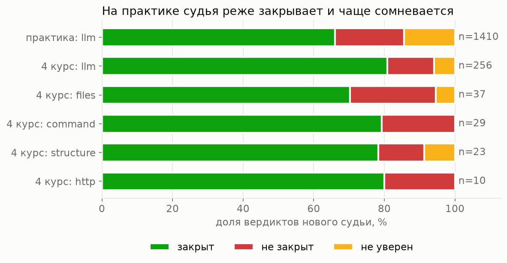
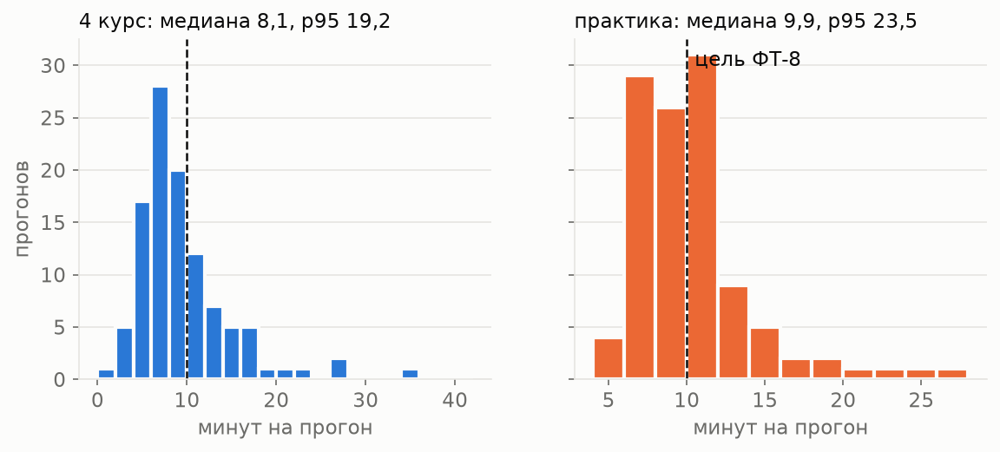
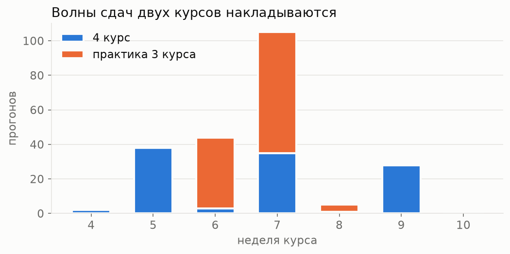

# Отчёт EDA: вердикты судьи на двух курсах

Срез на 8 ноября 2026 года: 4 курс «Системы ИИ» и практика 3 курса. Цель: понять, на каких данных можно мерить судью и что мешает это делать. Расчёты лежат в [`notebooks/eda.ipynb`](../notebooks/eda.ipynb), обезличенные данные в [`data/eda/`](../data/eda/README.md). По практике опубликованы только сводки: её репозитории закрытые.

| Что | 4 курс | Практика 3 курса |
|---|---|---|
| Команд или групп | 8 | 31 |
| Работ | 6 | 2 |
| Критериев | 82 | 10 |
| Прогонов нового судьи | 106 | 116 |
| Вердиктов нового судьи | 355 | 1410 |
| Закрытых приёмок | 25 | 59 |
| Отметок «агент ошибся» | 0 | 51 |

## 1. Состав и объём

**Вывод.** На 4 курсе 8 команд и 355 вердиктов нового судьи, на практике 31 группа и 1410 вердиктов. Вердикты внутри команды похожи, поэтому настоящий размер выборки определяет число команд: с практикой их стало 39 вместо 8, и интервалы по командам станут заметно уже. Неравномерность есть на обоих курсах: от 11 до 80 вердиктов на команду на 4 курсе и от 6 до 138 на практике. Значит, эталон отбираем с разбивкой по командам. На графике 4 курса учтён и перенос со старой платформы.

## 2. Качество данных

**Вывод.** На 4 курсе 50 прогонов перенесены со старой платформы без типа проверки и настоящего времени, дальше их не считаем; у одной приёмки таймер показывает 5263 минуты. Практику целиком проверял новый судья, но 7 прогонов упали, а таймером приёмки почти не пользовались: медиана 1 минута, поэтому время приёмки практики как метрика не годится. Метка версии у новых прогонов одна, хотя подсказки менялись. Отметки «агент ошибся» есть только на практике, их 51.

## 3. Что отвечает судья

**Вывод.** Практика для судьи труднее: закрыто 66% против 79% на 4 курсе, сомнений 15% против 5%. На практике всё проверяется пониманием текста (`llm`), а трудные критерии касаются источников: реальны ли источники (37% закрытых) и верно ли они процитированы (47%). Это другой тип работы, и он хорошо проверяет перенос судьи на чужой курс. Невыполненного на практике больше, поэтому она помогает и с редким классом.

## 4. Откуда берётся «не уверен» и насколько судья стабилен

**Вывод.** Ответы модели на практике расходятся чаще: в 10,8% вердиктов против 7,3% на 4 курсе. Откуда сомнения практики, по данным не восстановить: у 184 из 204 ответы модели не записаны. На 4 курсе 11 из 19 сомнений появились при единогласных ответах, то есть вердикт снимали правила. Итог критерия между проверками меняется в 28% случаев на практике и в 43% на 4 курсе, но сюда входят и доработки студентов; чистую повторяемость меряем на одном коммите.

## 5. Что видели люди

**Вывод.** На практике вопрос к приёмке есть у 68% закрытых вердиктов (631 из 931), на 4 курсе у 57%. Все 51 отметка «агент ошибся» сделаны на практике: 47 «зря не закрыл» и 4 «зря закрыл». Это первые метки людей по критериям, но смещённые: отмечали только замеченные ошибки, поэтому долю ошибок по ним не посчитать. Видно другое: на практике судья скорее слишком строг. Отметка о вопросе по-прежнему говорит об ответе студента, а не о верности вердикта.

## 6. Время, нагрузка и токены

**Вывод.** На практике прогон дольше: медиана 9,9 и 95-й процентиль 23,5 минуты против 8,1 и 19,2, максимум 97 минут; цель ФТ-8 в 10 минут не выполнена на обоих курсах. Волны курсов накладываются: на 7-й неделе вместе 105 прогонов, поэтому нагрузочный тест в ДЗ 4 строим на совмещённой волне, а не на среднем. Практика тратит больше токенов: около 740 тысяч на прогон против 640, доля кэша около 80% на обоих курсах.

## 7. Приёмка и перепроверки

**Вывод.** Приёмка 4 курса по таймеру занимает около 29 минут, на практике таймером почти не пользовались. Студенты сами запросили 38 перепроверок на 4 курсе и 29 на практике, ещё 32 запросили преподаватели практики: вердиктами пользуются обе стороны.

## Итог

Что берём в работу:

1. **Эталон.** Около 150 вердиктов 4 курса и отдельная выборка практики, обе отобраны случайно с разбивкой по командам и работам и с запасом по трудным критериям.
2. **Деление данных.** 4 курс для правок, две его команды отложены; практика целиком становится отложенным курсом и проверяет перенос судьи на чужой курс.
3. **Метрики.** Ошибки среди закрытых и ложные «не закрыт» отдельно, а не общая точность. Интервалы строим бутстрепом по командам.
4. **Споры практики.** 51 отметка идёт в разбор ошибок, а не в оценку: она смещена.
5. **Повторы.** Несколько прогонов на одном коммите для настоящей повторяемости.
6. **Версии и ответы.** В платформе записывать хеш подсказок и ответы модели у каждого вердикта.
