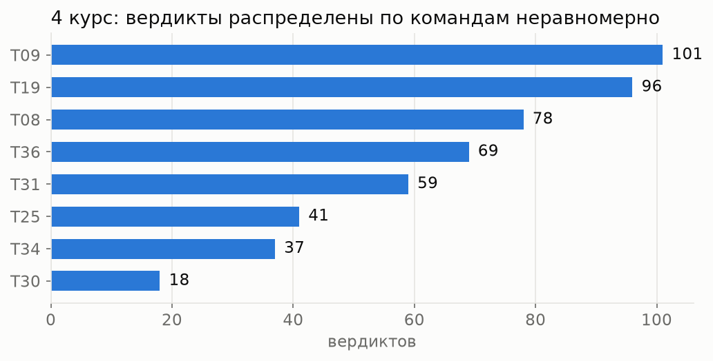
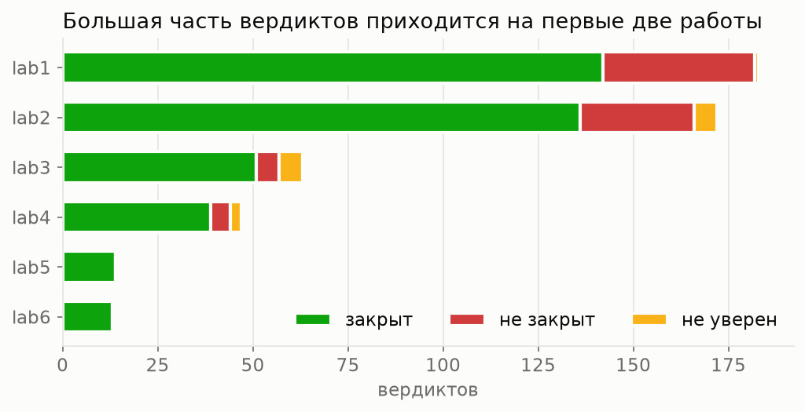
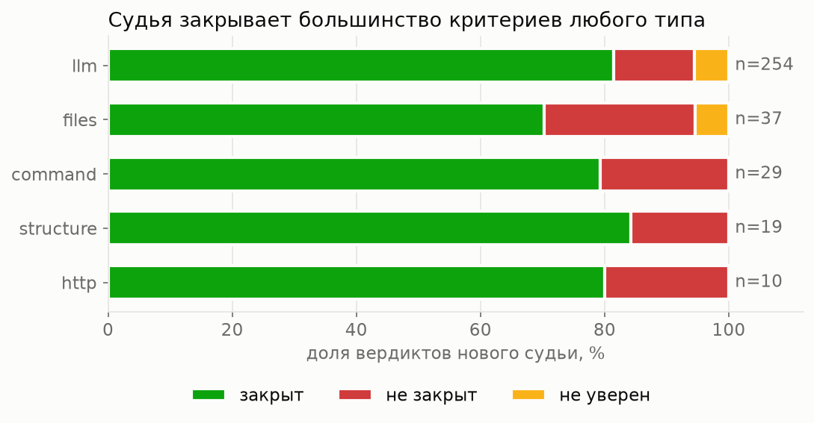
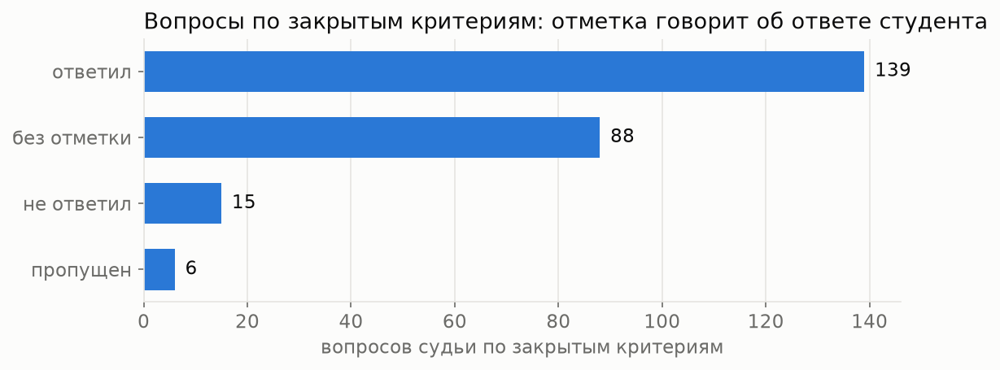
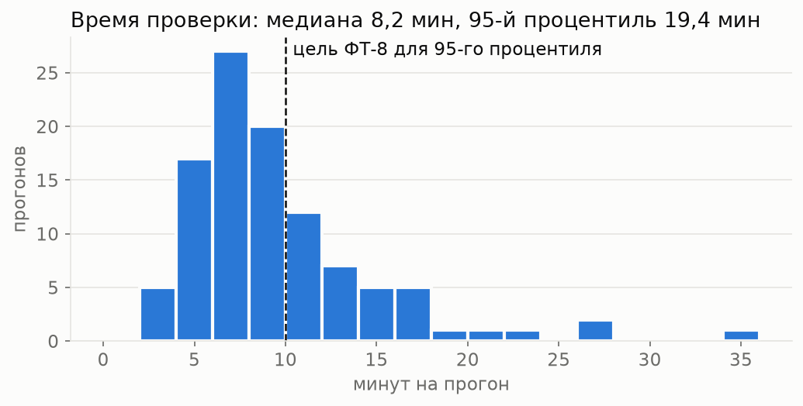
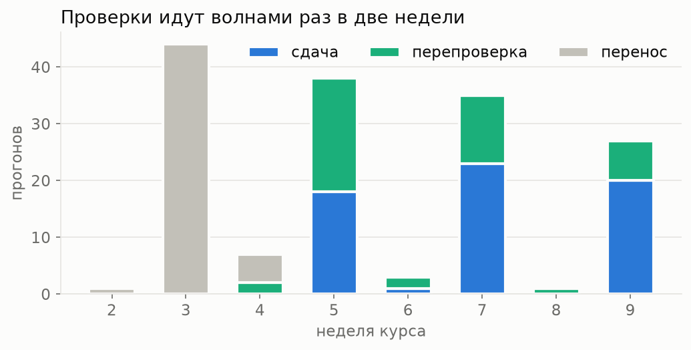
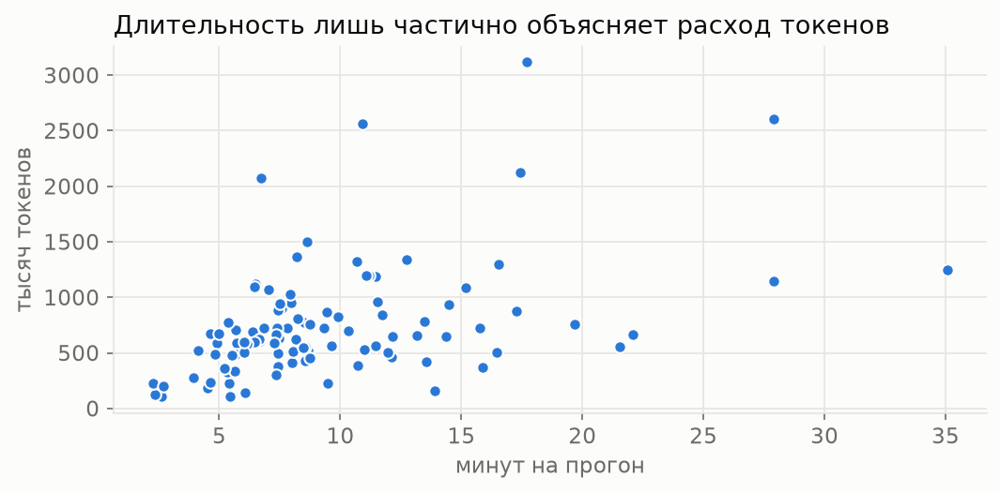

# Отчёт EDA: вердикты судьи на 4 курсе

Срез на 1 ноября 2026 года, поток 4 курса «Системы ИИ». Цель: понять, на каких данных можно мерить судью и что мешает это делать. Расчёты и таблицы лежат в [`notebooks/eda.ipynb`](../notebooks/eda.ipynb), обезличенные данные в [`data/eda/`](../data/eda/README.md).

| Что | Сколько |
|---|---|
| Команд | 8 |
| Работ | 6 |
| Критериев | 82 |
| Прогонов, из них нового судьи | 156, 104 |
| Вердиктов, из них нового судьи | 493, 349 |
| Закрытых приёмок | 25 |
| Меток эталона | 19, не вслепую |

## 1. Состав и объём

**Вывод.** Данных немного: 8 команд, 6 работ, 82 критерия, 493 вердикта, из них 349 от нового судьи. Вердикты зависят друг от друга внутри команды, поэтому настоящий размер выборки ближе к восьми, чем к пятистам. Самая крупная команда дала в 5,6 раза больше вердиктов, чем самая мелкая, а на первые две работы приходится 72% вердиктов. Значит, эталон надо отбирать с разбивкой по командам и работам, а части выборки делить по командам.

## 2. Качество данных

**Вывод.** Дублей нет, но смешаны две версии. 50 прогонов перенесены со старой платформы: у них нет типа проверки и настоящего времени, поэтому дальше считаем только нового судью. Поле версии у всех новых прогонов одно, `0.1.0`, хотя подсказки менялись, значит версии можно различить только по неделям. Ответы модели записаны не у всех вердиктов, поэтому голосование считаем на части данных. У одной приёмки таймер показывает 5263 минуты, поэтому для времени берём медиану. Главная проблема: отметок «агент ошибся» на потоке нет, так что качество нельзя посчитать без разметки.

## 3. Что отвечает судья

**Вывод.** Новый судья закрывает 80% критериев, не закрывает 15% и сомневается в 5%, покрытие 95%. Доля закрытых близка у всех типов проверки, ниже всего у `files`, но там всего 37 вердиктов. Невыполненных критериев мало, поэтому общая точность бесполезна: судья, закрывающий всё, получил бы около 80%. Нужны отдельные доли ложных «закрыто» и ложных «не закрыт». Трудные критерии сосредоточены в ресёрче, ERD и golden dataset, их стоит взять в эталон с запасом.

## 4. Откуда берётся «не уверен» и насколько судья стабилен

**Вывод.** Ответы модели расходятся редко, в 7,4% вердиктов с записанными ответами. Но 11 из 16 «не уверен» возникли при единогласных ответах: вердикт снимали правила судьи, а не сомнения модели. Значит, покрытие зависит от правил не меньше, чем от модели. У 43% критериев, проверенных несколько раз, итог менялся, но сюда входят и доработки студентов. Настоящую повторяемость надо мерить отдельными прогонами на одном коммите.

## 5. Что видели люди

**Вывод.** Вопрос к приёмке есть у 226 из 395 закрытых вердиктов (57%), остальные человек мог и не видеть. Отметка показывает, ответил ли студент, а не верен ли вердикт. Поэтому отметки не годятся как эталон, и ложные «закрыто» не появятся в данных сами. Нужна отдельная разметка случайной выборки.

## 6. Время, нагрузка и токены

**Вывод.** Медиана 8,2 минуты, но 95-й процентиль 19,4 почти вдвое выше цели ФТ-8 в 10 минут: треть прогонов идёт дольше, а 5 прогонов дольше 20 минут. Скорость надо улучшать наравне с качеством. Нагрузка идёт волнами: почти все проверки приходятся на недели 5, 7 и 9, до 38 прогонов в неделю, поэтому нагрузочный тест в ДЗ 4 надо строить на волне, а не на среднем. На прогон уходит около 650 тысяч токенов, 81% входных берутся из кэша. Связь токенов со временем умеренная (0,45), значит при сравнении версий надо смотреть на оба числа.

## 7. Приёмка и перепроверки

**Вывод.** Типичная приёмка занимает 29 минут, но зависит не только от судьи, поэтому это наблюдаемая метрика, а не цель. Студенты сами запросили 38 перепроверок из 42: значит, вердиктами пользуются, и перепроверки стоит считать бизнес-метрикой.

## Итог

Что берём в работу:

1. **Эталон.** Около 150 вердиктов нового судьи, отобранных случайно с разбивкой по командам, работам и типам проверки, с запасом по трудным критериям.
2. **Деление данных.** По командам. Работу прошлого года проверим как отдельную отложенную часть, если подойдут критерии.
3. **Метрики.** Ошибки среди закрытых и ложные «не закрыт» отдельно, а не общая точность. Интервалы строим бутстрепом по командам.
4. **Повторы.** Несколько прогонов на одном коммите для настоящей повторяемости.
5. **Версии.** В платформе записывать хеш подсказок, иначе версии судьи не сравнить по истории.
